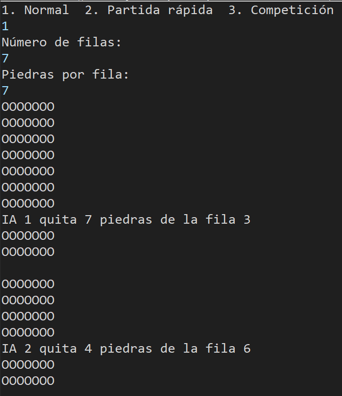
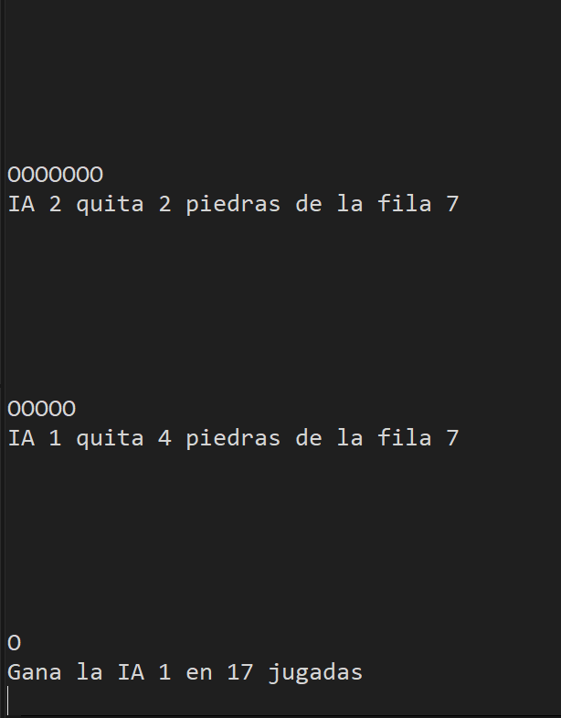

# Juego de los Pastores · modo Misère

Juego por turnos en Java: un árbitro de consola enfrenta a dos IAs que se ejecutan como procesos independientes.

## Reglas

1. Tablero de N filas con M piedras cada una (lo elige el usuario. Mínimo 1).
2. En su turno, cada IA quita al menos una piedra de una sola fila, como máximo todas las que tenga.
3. **Misère:** pierde quien quita la última piedra. Gana quien deja exactamente una.
4. Una jugada ilegal (fila inexistente, cantidad fuera de rango, respuesta ilegible o IA caída) pierde de inmediato.
5. En competición se alterna quién empieza.

## Cómo jugar

Requiere JDK 17 o superior.

Desde la raíz del proyecto (las rutas de `resources/rutas.txt` son relativas a ese directorio):

```
javac -d bin src/com/pastores/*.java
java -cp bin com.pastores.Arbitro
```

El árbitro pide por consola el modo (partida normal, rápida o competición), las filas, las piedras y, en competición, el número de partidas.





## Cómo funciona

El árbitro lanza cada IA con `ProcessBuilder` (`java -cp directorio clase`), cada una en su propia JVM, y se comunica con ellas por entrada y salida estándar, una línea por mensaje:

- Árbitro -> IA: el tablero (`6,6,6,6`) o `GAMEOVER` al terminar.
- IA -> árbitro: la jugada como `fila,cantidad`, con filas desde 0.

Las IAs se configuran en `resources/rutas.txt`, con dos líneas, una por jugador, con el formato `directorio,clase`:

```
./bin,com.pastores.IABasica
./bin,com.pastores.IAAvanzada
```

Si solo quieres usar una IA, repite la misma línea (`resources/rutas.txt` , por defecto, comienza solo con dos IAs básicas).

## Las IAs incluidas

- **IABasica:** elige al azar una fila con piedras y una cantidad válida. Solo garantiza que la jugada es legal.
- **IAAvanzada:** simula todas sus jugadas sobre una copia del tablero y las clasifica: ganadora (deja 1 piedra), buena (deja filas gemelas, como `2,2,5,5`, o un trío equilibrado, como `1,2,3`) o segura (el rival no puede dejar 1). Elige al azar dentro de la mejor categoría; si no hay ninguna, juega como la básica.


## Cómo añadir una IA (sin tocar el árbitro)

1. Crea una clase con su propio `main` que lea líneas de `System.in` (el tablero o `GAMEOVER`) y responda por `System.out` solo con `fila,cantidad`, con `flush`. Cualquier otro texto por `System.out` rompe el protocolo; para depurar usa `System.err`.
2. Compílala con el resto: `javac -d bin src/com/pastores/*.java`.
3. Cambia una de las dos líneas de `resources/rutas.txt`, por ejemplo `./bin,com.pastores.TuIA`.

Sirve cualquier programa que respete el protocolo, aunque esté escrito por otra persona o en otro lenguaje.
El protocolo es independiente del lenguaje, pero el árbitro actual solo sabe lanzar clases de Java.

## Qué mejoraría

- Un menú para elegir qué dos IAs enfrentar cuando `rutas.txt` tiene varias.

## Origen del proyecto

Parte de una práctica de 2.º de DAM: el protocolo de texto entre árbitro e IAs venía definido en el enunciado. El código del árbitro y las dos IAs los he desarrollado yo.